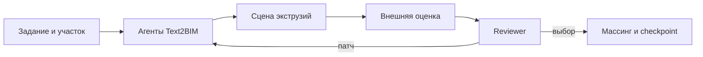

<div align="center">

# Text2BIM-Massing

**Генерация, оценка и улучшение архитектурных массингов по текстовому заданию**

[](https://github.com/rokerius/Text2BIM-Massing/actions/workflows/checks.yml)
[](pyproject.toml)
[](docs/validation.md)

[Быстрый старт](#быстрый-старт) · [API и CLI](docs/usage.md) · [Архитектура](docs/architecture.md) · [Документация](docs/README.md)

</div>

Самостоятельный baseline на основе
[Text2BIM](https://github.com/dcy0577/Text2BIM/tree/b71b83d0d6640e7dfe7af3fda17b40fb3cfd70dc).
Агенты создают Python-код для сцены экструзий, получают отчёт внешнего оценщика
и при необходимости изменяют выбранный вариант. На выходе — геометрия,
воспроизводимый checkpoint и история запуска. Формат совместим с
[massing-generation](https://github.com/evgmaslov/massing-generation/tree/607ff1fcf80477787409522d93e18e42ac1436cf).

> **Статус: standalone-этап завершён · 5 ноября 2026.**
> Генерация и внешняя оценка одного массинга, Reviewer-патчи и восстановление
> checkpoints реализованы и проверены. Версия пакета — `0.1.0`.
> Подключение к общему launcher и сравнительные эксперименты — следующий этап.

## Как это работает



Enhancer уточняет задание и при необходимости обращается к Architect.
Programmer строит сцену через инструменты, а Reviewer использует фактические
отчёты для продолжения или завершения работы. Роли, промпты и перенесённый
интерпретатор Text2BIM сохранены; Vectorworks/Solibri заменены сценой экструзий
и внешним оценщиком. [Подробная схема цикла](docs/architecture.md).

## Возможности

| Возможность | Что реализовано |
| --- | --- |
| Геометрия | Профили, отверстия, отдельные компоненты, экструзии, перенос, поворот, копирование и удаление. |
| Обратная связь | Фиксация кандидата → внешняя оценка → Reviewer-патч → повторная оценка и выбор. |
| Воспроизводимость | Стабильные IDs, атомарный журнал операций, восстановление переменных и проверка replay по snapshot. |
| Управление запуском | Отдельные процессы исполнения и оценки, лимиты, откат неудачной попытки, архив и кэш отчётов. |
| API и модели | Python API, JSON-конфигурация CLI, OpenAI Chat Completions и Codex CLI через ChatGPT login. |
| Внешняя интеграция | Адаптеры metric/processor/mesh и отдельный runner для одного здания в massing-generation. |

## Быстрый старт

Для примера геометрии достаточно Python 3.11–3.13; окружение разработки
закреплено на Python 3.12. LLM и внешний checkout для этого примера не нужны.

```bash
git clone https://github.com/rokerius/Text2BIM-Massing.git
cd Text2BIM-Massing
python3.12 -m venv .venv
source .venv/bin/activate
python -m pip install -e .
python examples/scene_without_llm.py > /tmp/text2bim-massing.json
```

Пример строит массинг с отверстием и отдельной компонентой и выводит JSON.
Сцена и экспорт используют метры; инструменты в примере принимают миллиметры.

### Генерация через Codex

Нужны установленный Codex CLI с ChatGPT login и локальный checkout
massing-generation на commit `607ff1fcf80477787409522d93e18e42ac1436cf`
с неизменённым `src/`.

```bash
python -m pip install -e '.[llm,maslov]'
codex login status
python -m text2bim_massing generate \
  --config examples/codex_maslov.json \
  --task-file examples/feedback_task.json \
  --maslov-repo /path/to/massing-generation \
  --output runs/feedback-01
```

Каталог результата должен быть пустым. Сценарий проверяет отдельный патч
с одного до двух этажей. Для фиксированной модели и требований из sample
используйте [runner интеграции](integrations/maslov/README.md) и
[режим requirements](integrations/maslov/requirements.md).
Конфигурация API-транспорта и Python API — в [руководстве запуска](docs/usage.md).

### Результаты запуска

| Артефакт | Содержимое |
| --- | --- |
| `selected_massing.json` | Геометрия выбранного оценённого кандидата. |
| `selected_code.py` + `checkpoint.json` | Исполняемый комплект для точного воспроизведения сцены и IDs. |
| `selected_source_code.py` | Исходный скрипт Programmer для provenance. |
| `result.json`, `candidates/` | Статус, расходы, кандидаты и их отчёты. |

Файлы выбранного кандидата появляются, если такой кандидат получен.
Для переноса `selected_code.py` сохраните рядом `checkpoint.json`.
[Контракт checkpoints](docs/checkpoints.md) · [Все артефакты](docs/usage.md).

## Проверки и происхождение кода

| Проверка | Подтверждённый результат |
| --- | --- |
| Автоматические тесты | 128 тестов на macOS и Linux, включая 12 проверок с исходным checkout massing-generation. |
| CI | Ubuntu, Python 3.11 / 3.12 / 3.13: Ruff, аудит переноса, pytest, сборка и пример. Внешние тесты без checkout пропускаются. |
| Checkpoints | Проверены replay, поздние переменные, выбор старого кандидата, rollback и перехваченный overflow журнала. |
| Живые сценарии | Feedback-патч, Architect и массинг с двором; отдельные Linux-запуски на реальном участке и требованиях CoMa 1627. |
| Перенос Text2BIM | Учтены 44 исходных файла и 156 объявлений. Интерпретатор перенесён целиком с одной правкой `SyntaxError`; четыре исходных промпта сохранены побайтово. |

Версии, расходы и все исходы живых проверок, включая неудачные попытки, — в
[отчёте валидации](docs/validation.md). Исторические запуски привязаны к своим
версиям и не служат сравнительным benchmark. Сырые артефакты хранятся локально
в `runs/` и не входят в clone.

## Область применения

Текущий сценарий — **одно требуемое здание на задачу**. Его массинг может
содержать несколько экструзий и отдельных компонент. Режим requirements берёт
этажность, высоту этажа и суммарную площадь из sample; неполные числовые цели
отклоняются. Подготовка через `--prepare-only` не вызывает LLM.

Общий launcher, несколько требуемых зданий, массовые прогоны и сравнительный
протокол относятся к [следующему этапу](docs/status.md#следующий-этап).
Параметризация и NSGA-II принадлежат внешнему методу и в baseline не включены.

`completed` означает решение Reviewer завершить запуск; выполнение требований
проверяется по отчёту выбранного кандидата. Оценщик считается доверенным кодом,
а ограниченный Python-worker не является полноценной OS sandbox.

## Документация

| Начать | Изучить | Проверить |
| --- | --- | --- |
| [Установка, API и CLI](docs/usage.md) | [Архитектура](docs/architecture.md) | [Результаты проверок](docs/validation.md) |
| [Интеграция с massing-generation](integrations/maslov/README.md) | [Контракт checkpoints](docs/checkpoints.md) | [Реестр отличий от Text2BIM](docs/text2bim-diff.md) |
| [Разработка и проверки](CONTRIBUTING.md) | [Текущий статус](docs/status.md) | [Источники и лицензии](THIRD_PARTY_NOTICES.md) |

[Все документы](docs/README.md) · [Следующий этап](docs/status.md#следующий-этап) · [История адаптации](docs/text2bim-adaptation.md)
