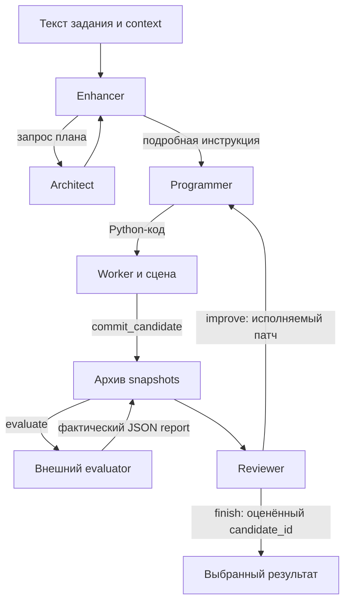

# Архитектура

`generate` координирует один независимый запуск. Конкретные цели и evaluator
передаются снаружи; ядро не знает критерия лучшего здания и не суммирует метрики.
Текущий результат — один массинг: список экструзий в метрах.

## Роли и цикл

Enhancer получает задание и context. Programmer получает ответ Enhancer,
как в исходном Text2BIM. Поэтому необходимые координаты и единицы должны
попасть в этот ответ. Architect вызывается только по запросу Enhancer.

Programmer создаёт или изменяет сцену через инструменты. Его ошибка исполнения
вызывает ограниченный цикл исправления. После успеха snapshot оценивается;
отсутствующую явную фиксацию/оценку выполняет host. Reviewer получает исходное
задание, context, сцену и архив фактических отчётов. Он возвращает JSON с
`action`, `candidate_id`, `guidance`. Нужный следующий шаг — исполняемый патч,
которому доступны сцена и переменные выбранного кандидата.

`completed` означает действие `finish` Reviewer. Проверка выполнения конкретных
требований остаётся за внешним отчётом и условиями эксперимента.

## Процессы и границы доступа

| Процесс | Ответственность | Передаваемые данные |
| --- | --- | --- |
| Host | Роли, бюджеты, LLM, архив, RPC и запись результатов. | Задание, snapshots, состояние и отчёты. |
| Code worker | Запуск исходного AST-интерпретатора Text2BIM с доступными инструментами сцены. | JSON-протокол; код не получает callable оценщика или LLM-ключи. |
| Evaluator worker | Выполнение доверенного внешнего callable в свежем Python-процессе с тайм-аутом. | Cloudpickle для evaluator, JSON-совместимый massing/context и JSON-отчёт. |
| Codex CLI, если выбран | Отдельный вызов транспорта для очередного ответа роли. | Промпт и JSON-конверт ответа; собственные tool actions CLI отклоняются. |

Code worker ограничивает AST, imports, builtins, время, размеры и на Linux
адресное пространство. Разрешены публичные math imports; произвольные функции,
классы и файловые операции не поддерживаются. Это не полноценная OS sandbox.
Evaluator считается доверенным кодом и не получает таких же ограничений Python.

Для данных и math aliases используется ограниченное сериализуемое состояние.
Передача evaluator через cloudpickle не относится к исполнению LLM-кода.

## Сцена, транзакции и выбор

`Scene` хранит объекты со стабильными UUID. Экструзия получает независимую
копию геометрии профиля. Редактирование профиля не меняет ранее созданный solid.
`SceneSnapshot` содержит неизменяемый сериализованный JSON; его представления
возвращают копии.

Успешная попытка исполнения принимает вместе сцену и переменные Python.
Неуспешная попытка не принимает ни то, ни другое; несколько code blocks одного
ответа объединяются в одну попытку. Пустой ответ без кода считается ошибкой.

`commit_candidate()` сохраняет snapshot, состояние и журнал фактических мутаций.
Если успешный скрипт заканчивается на точно таком же snapshot, его поздние
variables дополняют continuation-state без новой оценки. При другой сцене
или ошибке остаётся раннее состояние. Экспортируемый `code.py` воспроизводит
журнал с теми же IDs и проверяет snapshot; исходные попытки Programmer
сохраняются отдельно в `source_code.py`. Контракт — в [checkpoints.md](checkpoints.md).
`evaluate(candidate_id)` привязывает отчёт к этому snapshot, а повторный вызов
возвращает кэш. `select_candidate(candidate_id)` принимает только оценённый
кандидат и не запускает оценку заново.

Фиксация и оценка уже произошедших кандидатов не откатываются при последующей
ошибке скрипта: архив и потраченный бюджет сохраняются. Успешность скрипта и
наличие отчёта в архиве — разные события.

Reviewer может выбрать предыдущий кандидат. Для его дальнейшего патча host
восстанавливает соответствующие сцену, переменные и журнал. При завершении
`scene.json` остаётся последней принятой сценой исполнителя. Итог выбора
хранится в `selected_massing.json` и `selected_candidate` в result.

## Геометрический контракт

Внешний массинг — список экструзий с `polygons`, `bottom_elevation`,
`top_elevation` в метрах. Плоский список колец обрабатывается по семантике
исходных конвертеров massing-generation: вложенное кольцо вычитается, остальные объединяются.
Валидация и канонизация добавлены адаптацией; порядок колец стабилизируется
с проверкой топологического равенства.

Инструменты работают в выбранных `mm` или `m`, `Scene` — всегда в метрах.
Несколько компонент/экструзий относятся к одному выходному массингу; отдельные
здания с разными requirement IDs пока не моделируются контрактом generate.

## Где находится код

Все пути ниже относятся к `src/text2bim_massing/`, кроме последней строки.

| Файлы | Назначение |
| --- | --- |
| `geometry.py`, `scene.py`, `tools.py` | Формат, валидация, объекты сцены и инструменты. |
| `_vendor/text2bim/`, `prompts.py` | Перенесённый интерпретатор/utils/agents и явные адаптации рабочих промптов. |
| `workflow.py`, `archive.py` | Цикл ролей, обратная связь, кандидаты и выбор. |
| `execution.py`, `_worker.py` | Ограниченное исполнение кода и JSON RPC. |
| `runtime.py`, `_evaluate_worker.py` | Бюджеты, trace, LLM-wrapper и выполнение evaluator. |
| `llm.py`, `codex_client.py` | OpenAI API и Codex CLI transports. |
| `adapters.py`, `config.py`, `cli.py` | Вложенность внешних компонентов, конфигурация и точка входа. |
| `integrations/maslov/` от корня репозитория | Тонкий экспериментальный runner и конфиг; не часть ядра. |

Происхождение и необходимые отличия — в [source-map.md](source-map.md) и
[text2bim-diff.md](text2bim-diff.md). Форматы результатов и API — в
[usage.md](usage.md).
